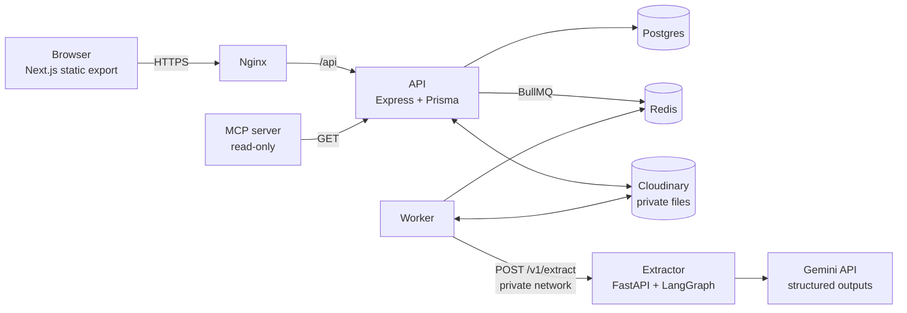

# InvoiceIQ

**The LLM proposes, rules verify, humans handle the uncertain cases, and accuracy is measured.**

InvoiceIQ is a multi-tenant platform for Indian GST invoices (PDF or image). An AI pipeline extracts
structured fields, deterministic validators check them, confident documents are auto-approved,
uncertain ones go to a human review queue, and reviewer corrections become labelled data that
measures accuracy.



- **Extraction:** one structured-output LLM call returns every value *as printed*. Code (not the LLM)
  parses numbers and dates, checks GSTIN checksums, does all arithmetic and decides.
- **Grounding:** every value must be found again in the document's words (PyMuPDF text layer or
  Tesseract OCR), giving it a page and a bounding box for the review screen.
- **Validators:** GSTIN format/state/check character, CGST+SGST vs IGST, line math, totals, dates,
  invoice number and HSN/SAC rules. Duplicate detection on supplier GSTIN + invoice number + total.
- **Bounded repair:** one LangGraph graph; failing fields are re-read at most twice.
- **Routing:** auto-approve only with no errors, all required fields grounded and confidence over the
  threshold. Confidence comes from grounding, OCR, validators and repair agreement, never the model.
- **Review:** split pane with highlighted boxes, confidence badges, validator messages, keyboard
  shortcuts. Corrections feed metrics, eval cases and few-shot hints for the same supplier.

## Results

Measured on a seeded suite of 150 synthetic GST invoices (5 layouts; 88 digital PDFs and 62 scans
with blur, noise, rotation and low resolution; 40 adversarial cases). Full tables and commands:
[docs/EVAL_REPORT.md](docs/EVAL_REPORT.md).

**No LLM API key was available while building**, so these numbers come from the **oracle** run: the
LLM is replaced by ground truth and everything else (OCR, grounding, validators, routing) runs for real.
They measure the safety net, not the model.

| What (oracle run, `python -m evals.run --extractor oracle`) | Result |
|---|---|
| Flawed invoices caught by validators (wrong totals, invalid GSTIN check characters) | **20 / 20**, and 0 auto-approved |
| Clean invoices sent to review unnecessarily | 12 / 130 (all scans where OCR could not confirm a required field) |
| Auto-approval at threshold 0.9 | 57.3% overall, 83.0% of digital PDFs; 100% of auto-approved were correct |
| Values found again in the document (grounding) | 96.9% overall; scans **44.3% → 92.6%** after the ruling-line fix (ablation) |
| Prompt-injection invoices that kept the true total / duplicate re-scans detected | 10 / 10 · 10 / 10 |
| Latency without the model (p50 / p95) | digital 327 ms / 1.0 s · scans 2.1 s / 8.1 s |
| Model accuracy, cost per document, latency with the model, tuned threshold | **NOT MEASURED**: needs an API key (commands in EVAL_REPORT §6) |

## Quickstart (local)

Requirements: Docker, Node 22 + pnpm 10, Python 3.12.

```bash
cp .env.example .env                       # works as-is without any keys
docker compose up --build                  # postgres, redis, extractor, api, worker, web
pnpm seed                                  # demo tenant + admin + reviewer (runs inside the api container)
python -m venv .venv && .venv/bin/pip install -r services/extractor/requirements-dev.txt -r evals/requirements.txt \
  && .venv/bin/pip install --no-deps -e services/extractor
.venv/bin/python -m evals.generate         # synthetic invoices
pnpm install && pnpm seed:samples          # upload 8 sample invoices through the API
```

Open http://localhost:3000 and sign in as `reviewer@demo.invoiceiq.test` / `demo-reviewer-password`
(admin: `admin@demo.invoiceiq.test` / `demo-admin-password`). Without a `GEMINI_API_KEY` in `.env` (free from aistudio.google.com),
uploads end as **failed** with a clear "llm_not_configured" reason; add a key (docs/SETUP.md) for
real extractions. Manual browser test: docs/MANUAL_TEST.md.

## Tests and evals

```bash
docker compose up -d postgres redis
pnpm test                                   # API (Vitest on real Postgres/Redis) + web unit tests
pnpm lint && pnpm typecheck && pnpm format:check
.venv/bin/pytest services/extractor/tests services/mcp/tests evals/tests
.venv/bin/ruff check services evals
python -m evals.run --extractor oracle      # needs tesseract, or use the eval image (evals/README.md)
python -m evals.gate                        # what CI runs
```

## Demo walkthrough

1. Sign in, drop a few PDFs/scans on **Documents**; rows move `uploaded → processing → auto approved /
   needs review` live.
2. Open **Review queue** → a flagged invoice: the document is on the left with boxes where each value was
   found (red = validator error), fields on the right with confidence and messages such as
   "subtotal + total tax + round-off = 6418.02 but grand total is 6918.02".
3. `j`/`k` walk the fields, `e` edits, `Ctrl+Enter` approves with your corrections, `Shift+R` rejects.
4. **Metrics** shows auto-approval rate, audited accuracy (10% of auto-approvals are sampled for audit),
   field correction rate, validator catch rate, cost per document and p50/p95 latency.
5. As admin, export approved invoices as CSV or JSON. `pnpm export:eval` turns reviewed documents into
   new eval cases.

## Repository

```
apps/web            Next.js (static export): login, documents, review, queue, metrics
apps/api            Express API + BullMQ worker, Prisma schema, scripts (seed, e2e, export:eval)
services/extractor  FastAPI + LangGraph pipeline, validators, grounding, LLM clients, contract
services/mcp        FastMCP read-only server (stdio)
evals               generator, metrics, runner, compare/gate/report, fixtures, results
deploy              compose.prod.yml, nginx, scripts (bootstrap, deploy, TLS, backup)
docs                ARCHITECTURE, DECISIONS, EVAL_REPORT, INTERVIEW_NOTES, DEPLOY, SETUP, KNOWN_ISSUES
```

## Docs

- [Architecture](docs/ARCHITECTURE.md) · [Decisions](docs/DECISIONS.md) · [Eval report](docs/EVAL_REPORT.md)
- [Setup: keys and console settings](docs/SETUP.md) · [Deploy to EC2](docs/DEPLOY.md)
- [Known issues](docs/KNOWN_ISSUES.md) · [Interview notes](docs/INTERVIEW_NOTES.md) · [Manual test](docs/MANUAL_TEST.md)

Stack: TypeScript, Python, SQL · Next.js 16, React 19, Tailwind 4, TanStack Query, react-pdf ·
Express 5, Prisma 6, Zod 4, BullMQ 5, pino, JWT, multer · FastAPI, Pydantic 2, LangGraph, Google Gen AI SDK (Gemini; OpenAI optional),
PyMuPDF, Tesseract, Pillow, rapidfuzz · PostgreSQL 16, Redis, Docker Compose, Nginx, GitHub Actions,
GHCR, one AWS EC2 instance, Cloudinary · Vitest, pytest, Ruff, ESLint, Prettier · FastMCP.

All invoice data in this repository is synthetic: names and GSTINs are random combinations with
computed check characters.
