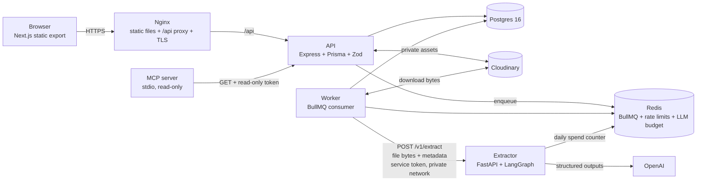
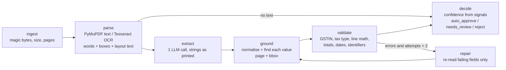
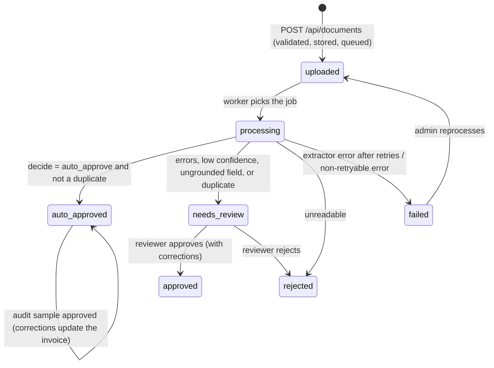

# Architecture

**The LLM proposes, rules verify, humans handle the uncertain cases, and accuracy is measured.**

## Responsibilities

| Component | Owns | Never does |
|---|---|---|
| `apps/web` | Login, upload, document list, review screen, metrics, export | Talk to Cloudinary or the extractor |
| `apps/api` (server) | Auth, tenants, documents, review tasks, corrections, metrics, export, duplicate checks | Call the LLM |
| `apps/api` (worker) | Queue consumption, retries, Cloudinary download, persisting results | Serve HTTP (only a health probe) |
| `services/extractor` | The AI pipeline: parse, extract, ground, validate, repair, decide | Touch the database or Cloudinary |
| `services/mcp` | Read-only tools over the API | Write anything |

## Pipeline (one LangGraph graph)

- The model only **reads**: it returns strings exactly as printed (DECISIONS D-017). Code parses
  numbers and dates, checks GSTIN checksums, does all arithmetic and decides.
- Document text is untrusted: delimited as data, the system prompt forbids following it, the output is
  schema-validated, and validators plus grounding catch a hijacked answer (tested).
- Confidence = grounding × OCR × validator × repair-agreement factors (D-019); never the model's opinion.

## Document lifecycle

Every closed review stores corrections (`before`, `after`, `had_validator_issue`). They feed the
metrics page, `pnpm export:eval` (new eval cases) and few-shot hints for the same supplier GSTIN.

## Data model

`tenants`, `users` (admin | reviewer), `refresh_tokens` (rotation families), `documents`,
`extraction_runs` (unique document_id + attempt), `extracted_fields` (path, value, confidence, page,
bbox, issues), `review_tasks` (needs_review | audit), `corrections`, `invoices` (normalised approved
data), `suppliers`, `audit_log` (append-only). Every tenant-scoped table has `tenant_id`, and every
query goes through a repository function that takes a `tenantId` first
(`apps/api/src/modules/**/**.repository.ts`). `test/integration/tenantIsolation.test.ts` proves
cross-tenant reads and writes fail.

## Contracts between services

- `POST /v1/extract`: multipart `file` + `metadata` (JSON). Pydantic models in
  `services/extractor/extractor/schemas/contract.py`, mirrored in Zod in
  `apps/api/src/extractor/extractorSchemas.ts`. `python -m extractor.contract_export` writes the
  JSON Schemas to `services/extractor/contract/`; `apps/api/test/unit/extractorContract.test.ts`
  compares them with the Zod schemas, and a Python test checks the files are current.
- Error codes: 4xx and 429 (budget) are final; 5xx are retried with exponential backoff, except
  configuration errors (`llm_not_configured`, `llm_replay_miss`, `ocr_unavailable`).

## Where things are

| Concern | File |
|---|---|
| Validators | `services/extractor/extractor/validators/` |
| Grounding | `services/extractor/extractor/grounding/` |
| Graph | `services/extractor/extractor/pipeline/graph.py` |
| Prompts | `services/extractor/extractor/prompts.py` |
| LLM clients (live/record/replay/fake), budget, pricing | `services/extractor/extractor/llm/` |
| Queue + persistence | `apps/api/src/queue/` |
| Review + corrections | `apps/api/src/modules/review/` |
| Metrics SQL | `apps/api/src/modules/metrics/metrics.queries.ts` |
| Review screen | `apps/web/src/components/review/` |
| Eval harness | `evals/` |
| Deploy | `deploy/` |
